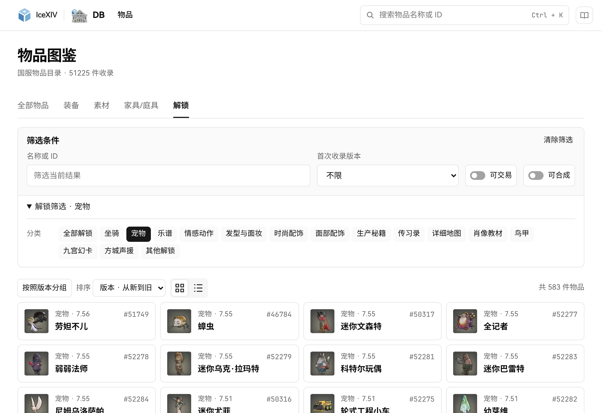
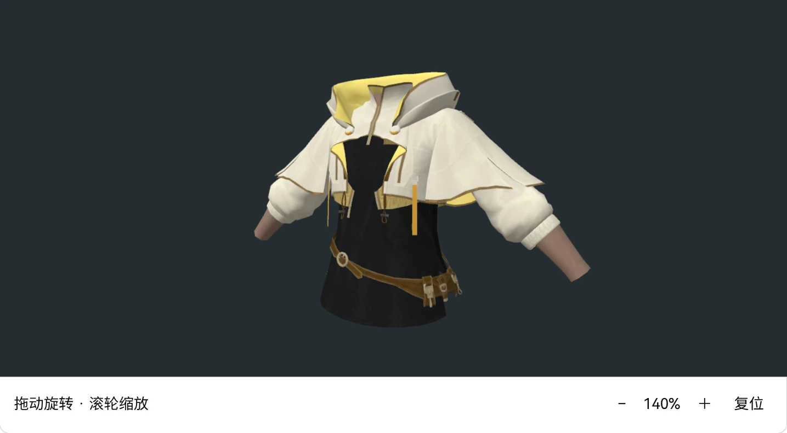
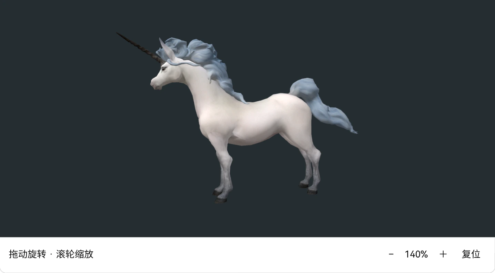
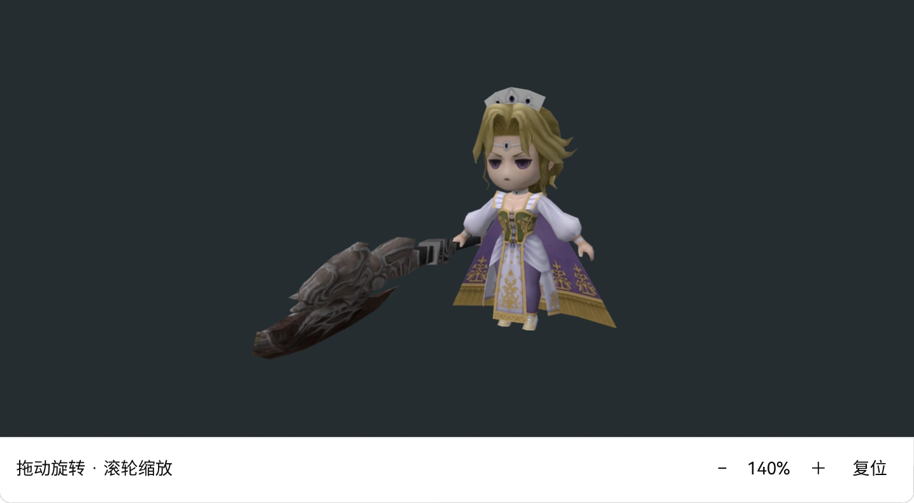
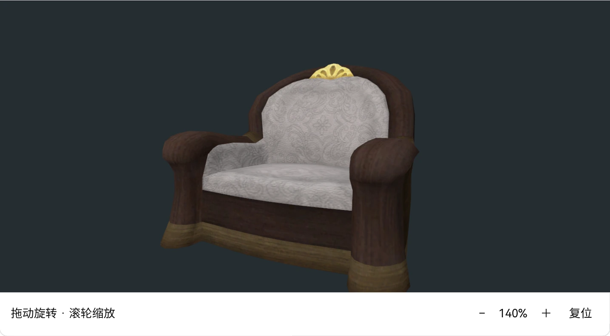
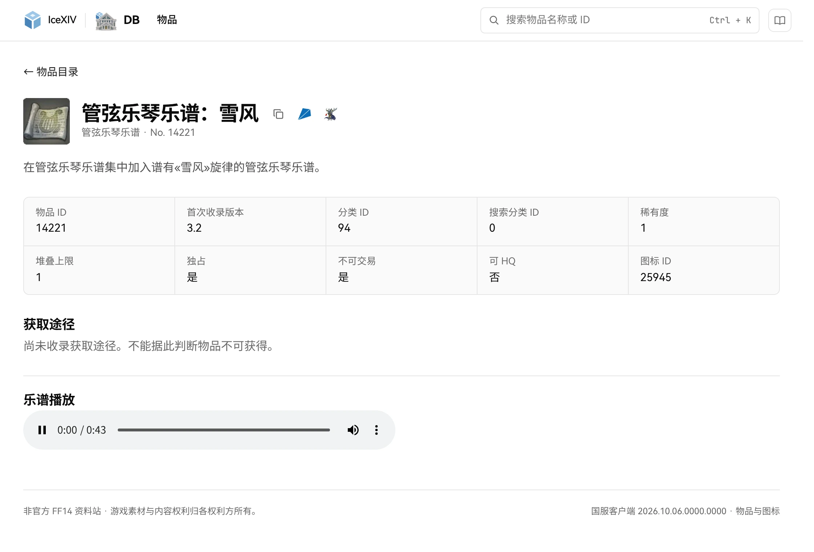

@!(title: "DB", template: "project")

#import "../components/media.not" as media;

收录国服 51,000+ 件物品资料，支持按版本、职业、部位与解锁分类筛选，并在网页内直接查看三维模型、回放情感动作与试听管弦乐琴乐谱。

- 全量国服物品目录、配方树与同模型装备关联
- 装备、坐骑、宠物与家具三维模型实时旋转预览
- 管弦乐琴乐谱在线试听与肖像教材解锁部件预览
- 静态预渲染与 `Ctrl + K` 快捷检索

#media.screenshot[

]

### 三维模型预览

在物品详情页内直接加载游戏原生模型，支持拖拽旋转、滚轮缩放与情感动作回放。

#media.models[

]

### 乐谱试听与肖像教材

每件乐谱附带网页音频播放器，肖像教材完整列出解锁的背景、装饰框、装饰物与姿势。

#media.spread[

]
