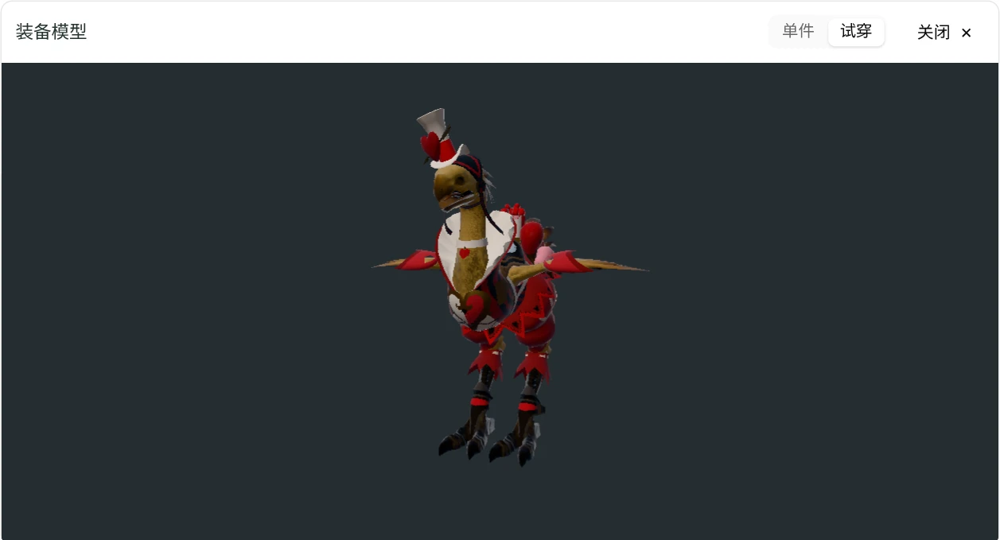
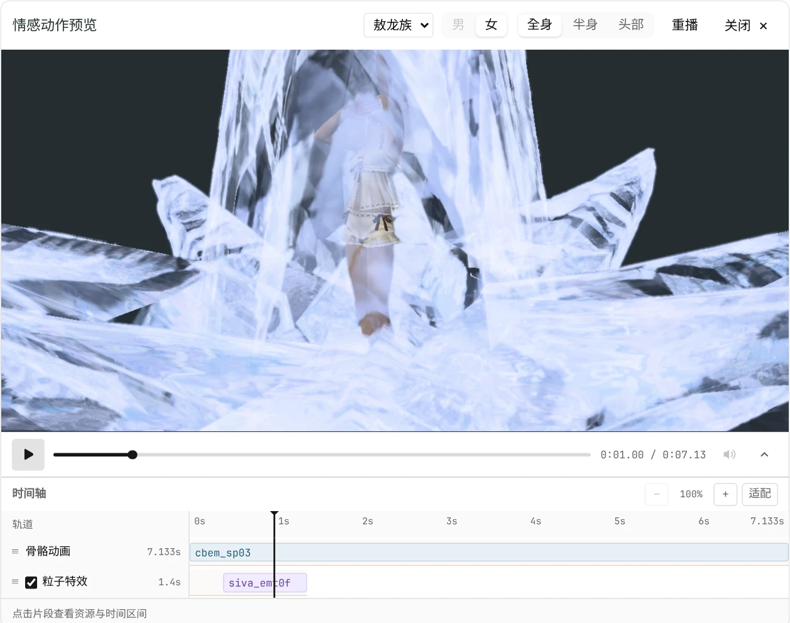
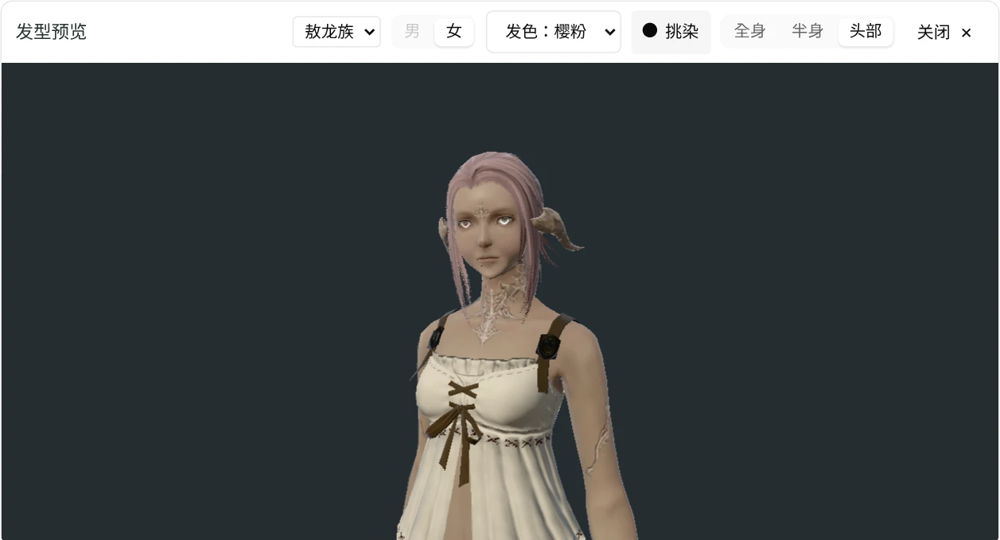
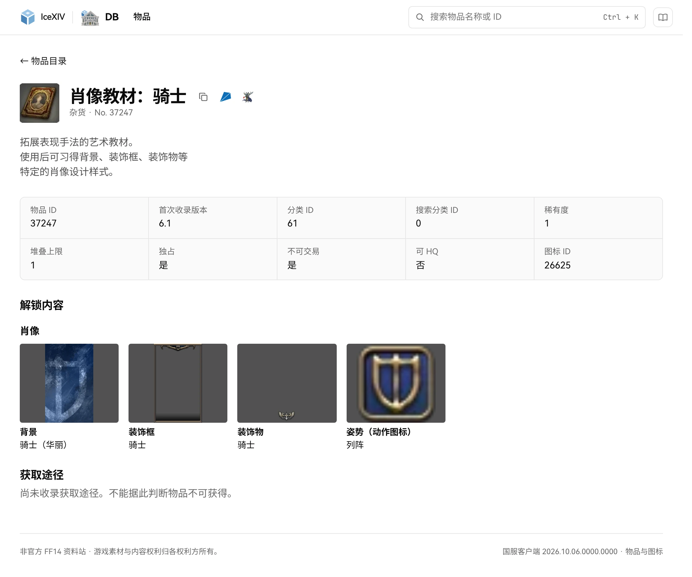

@!(title: "DB", template: "project")

#import "../components/media.not" as media;

收录国服 51,000+ 件物品资料，支持按版本、职业、部位与解锁分类筛选，并在网页内直接进行 WebGPU 三维模型预览、角色/陆行鸟试穿、发型面妆换色、多轨时间轴情感动作回放与管弦乐琴乐谱试听。

- 全量国服物品目录、配方树与同模型装备关联
- 装备、武器、坐骑、宠物、家具与鸟甲三维预览，支持「单件 / 试穿」与多种族体型切换
- 情感动作多阶段回放（含粒子特效与 3D 道具）及可展开多轨时间轴，发型与面妆支持头部特写与实时换色
- 管弦乐琴乐谱在线试听、肖像教材解锁部件预览与 `Ctrl + K` 快捷检索

#media.screenshot[

]

### 三维模型、试穿与时间轴预览

基于统一 WebGPU 渲染管线在物品详情页直接加载游戏原生模型、骨骼动作、粒子特效（AVFX）与 3D 道具：支持角色与陆行鸟试穿、多种族/性别与镜头预设切换、发型/面妆实时换色与挑染，以及可展开的多轨时间轴（支持按轨道显隐与进度拖动）。

#media.fan[

]

### 乐谱试听与肖像教材

每件乐谱附带网页音频播放器，肖像教材完整列出解锁的背景、装饰框、装饰物与姿势。

#media.spread[

]
