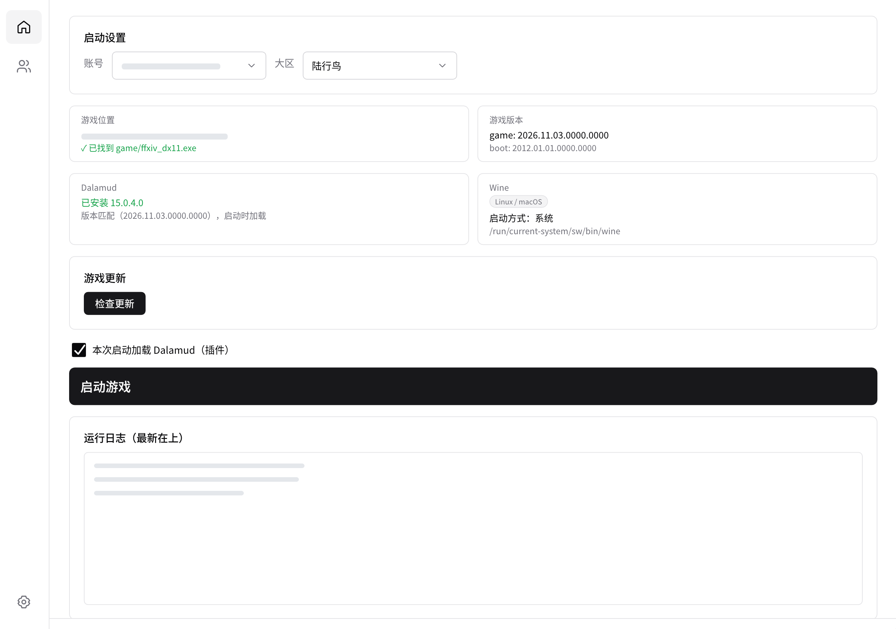

@!(title: "Eorzea", template: "project")

#import "../components/media.not" as media;

Windows 原生启动，Linux / macOS 通过 Wine 运行。集成 Dalamud，多帐号支持。

- Windows / Linux / macOS
- Dalamud 插件框架
- 多帐号支持

### 命令行工具

也可以使用独立的 CLI：`eoz`。已安装 Rust 工具链时，可从 Git 源码安装，无需编译 App；首次安装需要编译时间及对应平台的构建依赖。

```sh
cargo install --git https://github.com/icexiv/eorzea --locked eorzea-cli
```

安装后运行 `eoz --help` 查看用法。此方式跟随仓库默认分支，不代表正式版。

#media.screenshot[

]
